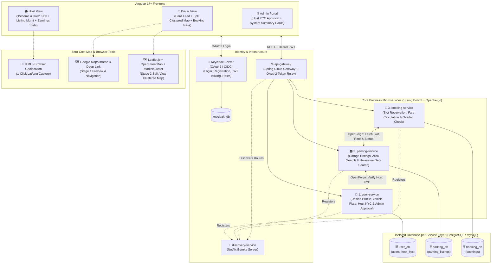
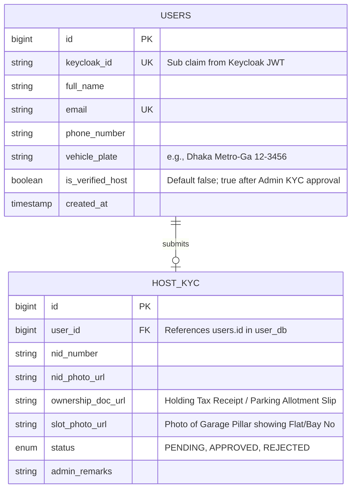
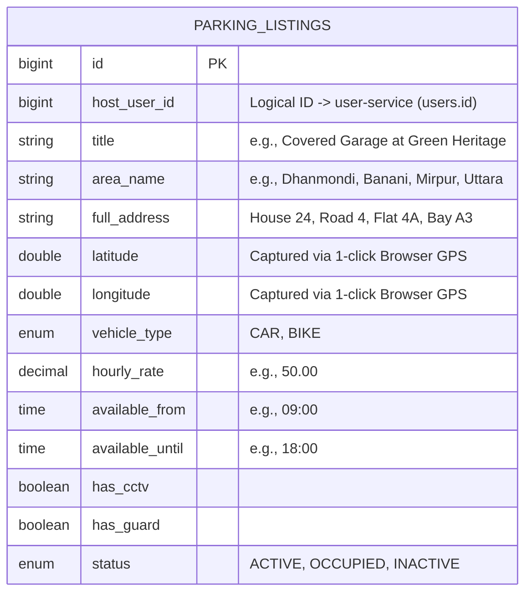
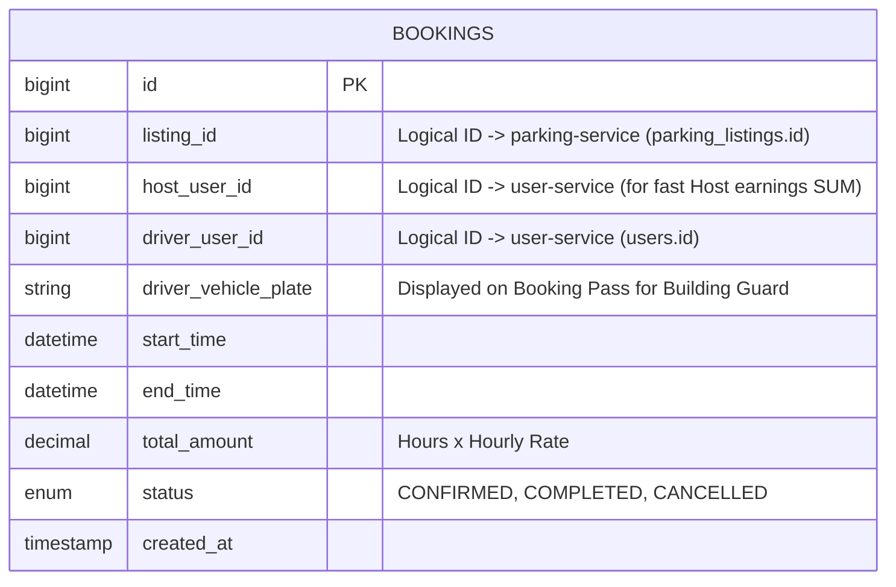
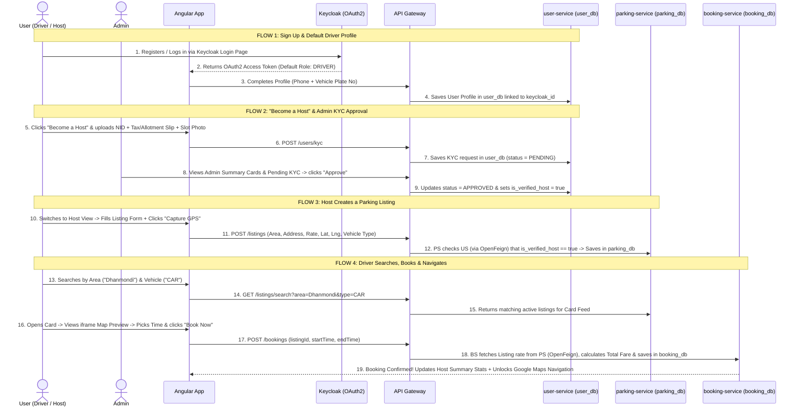
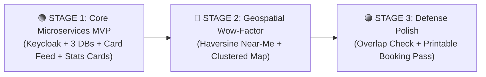

# Nirapod Parking: Complete System Blueprint & Defense Specification

> **Execution Strategy:**
> * **Stage 1 (Core Microservices + Minimal MVP):** Lay out the enterprise Spring Cloud Microservices architecture (`api-gateway`, `discovery-service`, `user-service`, `parking-service`, `booking-service`) with **Database-per-Service isolation**, secured by **Keycloak (OAuth2 / OIDC)**, including Card-First search, online KYC, basic booking, and **Host/Admin Dashboard Summary Cards (`SUM`/`COUNT`)**.
> * **Stage 2 (Geospatial "Wow Factor"):** Plug in **Haversine Proximity Search** (*"Find Near Me"*) and the **Airbnb-style Split-View Leaflet Clustered Map** (`Leaflet.markercluster`) using the GPS coordinates already captured in Stage 1.
> * **Stage 3 (Lightweight Defense Polish):** Add a simple SQL overlap check (preventing double-booking) and a printable **Digital Parking Pass** (with Vehicle Plate matching).

---

## 1. System Architecture (Microservices + Database-per-Service + Keycloak OAuth2)

---

## 2. Database-per-Service Schema (3 Isolated Databases, 4 Core Tables)

Each microservice owns its own isolated database. There are **no cross-database foreign keys**; cross-service references (`host_user_id`, `listing_id`, `driver_user_id`) are stored as logical IDs and validated via **OpenFeign** REST calls.

### A. `user_db` (Owned exclusively by `user-service`)

### B. `parking_db` (Owned exclusively by `parking-service`)

### C. `booking_db` (Owned exclusively by `booking-service`)

---

## 3. Stage 1 End-to-End Sequence Workflow

### Unified Dual-Role Concept (The "Mirpur-to-Banani Commuter" Model)
Every user signs up once via **Keycloak** and starts as a **Driver** by default. If they also own a flat with an empty daytime garage, they click **`[ 🏠 Become a Host ]`**, upload their KYC proof, and once approved by the Admin, they can switch freely between **`Driver View`** and **`Host Dashboard`** using the same account.

---

## 4. Three-Stage Build Roadmap

### 🟢 STAGE 1: Core Microservices Architecture + Minimal Functional MVP
*Goal: Get the entire distributed architecture, isolated databases, and core end-to-end flow running first.*
* **Infrastructure Setup:** Run Keycloak (`keycloak_db`), `discovery-service` (Eureka), and `api-gateway` (Spring Cloud Gateway).
* **`user-service` (`user_db`):** Sync logged-in Keycloak user, save Driver phone & vehicle plate, submit Host KYC form (NID + Holding Tax/Allotment Slip + Slot Photo), and Admin 1-click `[Approve]` button.
* **`parking-service` (`parking_db`):** Verified Host creates a parking listing with 1-click browser GPS (`navigator.geolocation`), toggles spot status (`ACTIVE / INACTIVE`), and Driver searches by **Area dropdown** + **Vehicle Type** in a clean **Card Feed**.
* **`booking-service` (`booking_db`):** Driver books a spot for a selected time window; service calls `parking-service` via **OpenFeign** to calculate price (`Hours × Rate`), saves booking, and unlocks the **Google Maps iframe preview** & **URL navigation redirect**.
* **Basic Dashboard Summary Cards (`SUM` / `COUNT`):**
  * **Host Dashboard:** 3 counter cards showing *Active Spots* (`COUNT` from `parking_db`), *Total Bookings* (`COUNT` from `booking_db`), and *Total Earnings ৳* (`SUM(total_amount)` from `booking_db`).
  * **Admin Portal:** 3 counter cards showing *Pending KYC Requests*, *Verified Hosts* (`COUNT` from `user_db`), and *Total Active Listings* (`COUNT` from `parking_db`).

---

### 🔵 STAGE 2: Geospatial "Wow Factor" Upgrades
*Goal: Add high-impact visual and algorithmic features for the Defense Committee without changing your database schema.*
* **"Find Near Me" Proximity Search (Haversine SQL):** Add a single `@Query` in `parking-service` using the Haversine distance formula so drivers can find spots within `2 km` of their current GPS coordinate and see **`"0.4 km away"`** on every card.
* **Airbnb-Style Split Screen (Card Feed + Leaflet Clustered Map):**
  * Render **Leaflet.js + OpenStreetMap** (100% free, no API key) alongside the Card Feed.
  * Add **`Leaflet.markercluster`** so if 3 flat owners in the same building list spots at the same coordinate, the map automatically groups them into a **`(3)`** cluster pin that fans out ("spiderfies") when clicked.
  * Clicking a card smoothly pans/zooms the map (`map.flyTo`) to that building's pin.

---

### 🟣 STAGE 3: Minimal, High-Visual Polish for Final Defense
*Goal: Quick 1-hour additions that make the live demo look complete without complex business logic.*
* **Simple Double-Booking Prevention:** A single SQL `COUNT(*)` check in `booking-service` ensuring no existing `CONFIRMED` booking overlaps the requested `start_time` and `end_time`.
* **Printable Digital Parking Pass:** A clean ticket screen showing the Booking ID, **Driver's Vehicle Plate Number** (so the building guard can visually verify the car at the gate), Host address/phone, time window, and a simulated *"Paid via Mock Wallet"* badge.

---

## 5. How This Maps to Your University Defense Phases

| Defense Phase | What You Present / Demo | Why It Wins Marks |
| :--- | :--- | :--- |
| **Phase 1: Title Defense** *(Current)* | Present the **Microservices + Database-per-Service Architecture**, **Isolated ERDs**, **Dual-Role KYC concept**, and the **3-Stage Roadmap**. | Shows true microservices isolation (`user_db`, `parking_db`, `booking_db`) + Keycloak OAuth2 + OpenFeign + Geospatial clustering. |
| **Phase 2: Pre-Defense** *(Mid-term)* | Demo **Stage 1 (100% Working Microservices MVP + Dashboard Summary Cards)** + start of **Stage 2**. | Complete working flow from Keycloak login $\rightarrow$ Host KYC approval $\rightarrow$ Listing creation $\rightarrow$ Booking & live dashboard counters. |
| **Phase 3: Final Defense** *(End-term)* | Demo **Stage 1 + Stage 2 (Haversine + Clustered Map) + Stage 3 (Overlap Prevention & Digital Pass)**. | Visual split-screen map clustering + live proximity search + complete microservices demonstration. |
