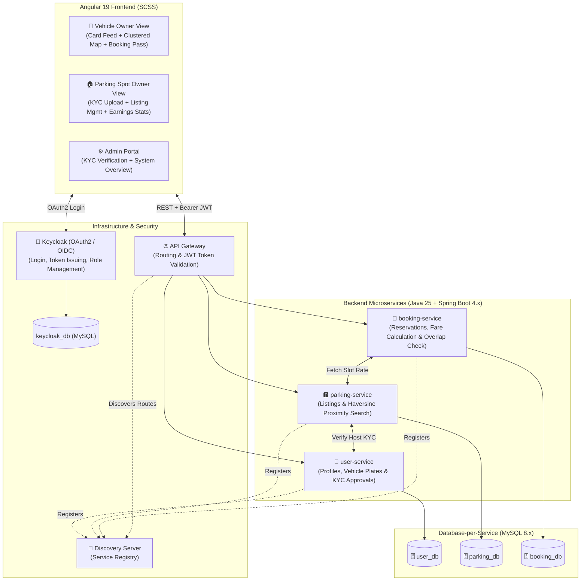
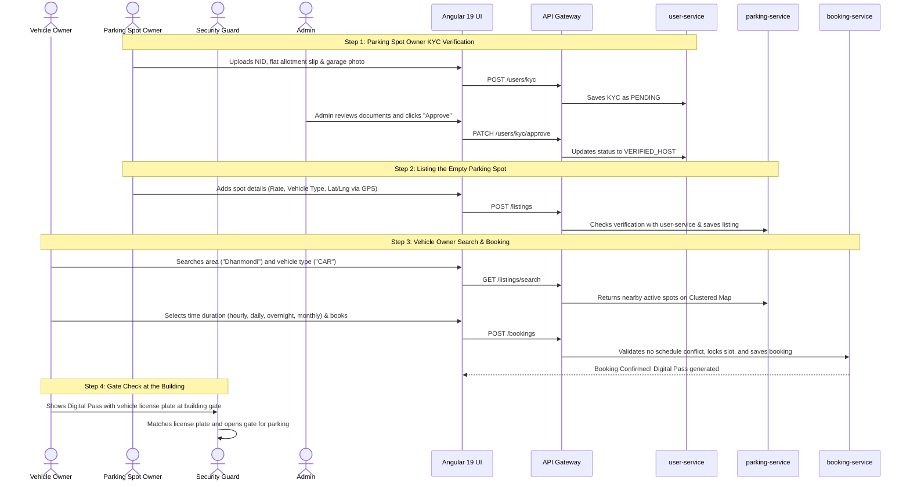

# Nirapod Parking: FYDP Proposal Approval Form (Section V)

**Course Code:** CSE499 | **Course Title:** Final Year Design Project (Title Defense)
**Institution:** Daffodil International University (DIU), Department of Computer Science & Engineering
**Proposed Title:** Nirapod Parking - A Microservice-Based Web Platform for Sharing Residential Parking Spaces in Urban Areas

---

# 1. Objective

The main objective of this project is to develop **Nirapod Parking**, an easy-to-use web platform designed for crowded urban centers like Dhaka and Chattogram. The platform connects **Vehicle Owners** (commuters driving cars or motorcycles) who need safe, temporary parking with **Parking Spot Owners** (residential flat owners or authorized residents) who have empty, unused garage spaces. Through our system, drivers can easily find and reserve parking for a few hours, for a full workday, overnight, or on a monthly subscription basis.

In busy commercial and residential areas such as Dhanmondi, Banani, Motijheel, and Agrabad, finding parking is an exhausting everyday struggle. Drivers frequently spend 20 to 45 minutes circling congested streets, wasting expensive fuel and worsening citywide traffic jams. Because our cities have almost no dedicated public parking facilities, vehicle owners are forced to park on roadside streets where their cars and bikes regularly suffer body scratches, stolen parts (such as side mirrors, helmets, or batteries), and police towing fines. At the same time, thousands of private residential parking bays sit completely empty during the day while flat owners are away at work. Many other spots stay vacant permanently because a family does not own a vehicle, an expatriate flat owner lives abroad, or a tenant simply has no personal car or bike. Currently, there is no organized or trustworthy way for residential flat owners to share these idle spaces with daily commuters.

Nirapod Parking solves this problem by providing a completely software-based sharing platform that requires zero expensive hardware or gate sensors. Vehicle Owners can search for available nearby spots on an interactive clustered map, book parking according to their preferred schedule, and receive a digital booking pass with their vehicle license plate number. To ensure building security, an **Admin** verifies the Parking Spot Owner's National ID, property allotment papers, and garage photos before any spot goes live, while the building's **Security Guard** can quickly verify incoming vehicles at the gate simply by matching the license plate number on the digital pass.

---

# 2. Motivation

Over the last few years, the sharing economy has transformed urban mobility across Bangladesh. Platforms like Pathao and Uber proved that solving city transportation does not require adding thousands of new vehicles, but rather making smart use of empty seats in cars and motorbikes already on the road. Similarly, platforms like Airbnb proved that vacant residential rooms could solve accommodation shortages without building new hotels. Nirapod Parking is inspired by this exact concept: **bringing the sharing economy to Bangladesh's untouched parking sector.** Every day in Dhaka, two-lane roads are blocked by parked vehicles, while right behind the boundary gates of adjacent residential buildings, dozens of covered parking spots sit completely vacant. Unlocking this hidden, private capacity is the driving inspiration behind our project.

Anyone who travels through Dhaka or Chattogram experiences the intense daily anxiety of finding parking. Vehicle drivers heading to universities, offices, or medical appointments face constant mental stress, frequently arriving late because they must circle blocks in gridlocked traffic. Once parked on the street, commuters spend their entire day worrying about vehicle damage, theft, or police towing fines. At the same time, municipal authorities cannot build new multi-story public parking lots in crowded commercial hubs because there is simply no open land available, and land acquisition costs are astronomical. Nirapod Parking provides an immediate, zero-cost alternative by taking parked vehicles off narrow streets and moving them into existing residential garages, easing road congestion without requiring any government spending or public land acquisition.

When reviewing smart parking research, almost all published academic papers focus heavily on complex IoT hardware—such as ultrasonic ground sensors, automated boom barriers, and dedicated surveillance cameras. While these systems work in commercial shopping malls, they are completely impractical and cost-prohibitive for ordinary apartment buildings in South Asia. Furthermore, existing research largely ignores community-based parking sharing models that accommodate local apartment realities, such as locked gates, on-duty Security Guards, and multiple flat owners sharing a single compound. Nirapod Parking addresses this research gap by demonstrating a purely software-based, zero-hardware marketplace tailored specifically for residential communities, while providing middle-class flat owners with a steady source of passive monthly income (estimated at ৳3,000 to ৳8,000) from an otherwise wasted space.

---

# 3. Background Study

To prepare for this project, we reviewed existing academic literature and real-world parking solutions both globally and locally in Bangladesh. Previous work in this domain can be divided into three main areas:

First, a large body of university research papers focuses on automated parking systems built with physical hardware. Researchers commonly install ultrasonic sensors, magnetic detectors, or camera-based image processing systems at each parking slot to track occupancy, connecting them to cloud servers using microcontrollers like Arduino or Raspberry Pi. These studies have established an important finding: giving drivers real-time slot availability and the ability to reserve spots in advance can reduce cruising and searching time by up to 30% to 50%. However, these systems are almost always evaluated in controlled lab settings or commercial shopping malls; in real life, buying, wiring, and maintaining expensive hardware in ordinary residential apartment buildings across Dhaka is financially and practically impossible.

Second, in Western countries, commercial platforms such as JustPark in the UK and SpotHero in the USA popularized peer-to-peer parking sharing by letting homeowners rent out their private driveways through mobile apps. These platforms proved that sharing private parking spaces works effectively, generates passive income for property owners, and takes cars off busy roads. However, these apps were designed for Western single-family suburban houses with open, unmonitored driveways and direct credit card billing. In Dhaka and Chattogram, residential buildings are multi-story apartment complexes with locked gates, on-duty **Security Guards**, and multiple **residential flat owners** sharing the same ground-floor garage. Foreign apps offer no mechanism to verify flat ownership, handle building security, or support gate security staff.

Third, in Bangladesh, platforms like Pathao, Uber, and Jatri successfully modernized ride-sharing and bus ticketing, but vehicle parking was completely left out of this digital transition. Currently, parking in cities like Dhaka relies either on commercial shopping mall basements, informal roadside parking with cash slips, or handwritten paper "Garage To-Let" notices pasted on building boundary walls. These manual paper notices are slow, unorganized, completely unverified, and only work for long-term monthly rentals. They cannot help a commuter who needs a safe spot for just two hours during a meeting or overnight for an event. Nirapod Parking steps in to bridge these gaps by providing a modern web platform built specifically around local residential customs.

---

# 4. Gap Analysis

While international commercial platforms like JustPark (UK) and SpotHero (USA) have popularized peer-to-peer parking sharing in Western countries, they fail when applied to the realities of Bangladesh. Furthermore, academic research papers have primarily focused on expensive IoT hardware that is impractical for ordinary residential buildings. Our analysis identifies five realistic practical gaps:

1. **The Expensive Hardware & Maintenance Gap (Academic IoT Papers):** Most academic research papers suggest installing ultrasonic ground sensors, surveillance cameras, and automated barrier gates connected to microcontrollers like Arduino or Raspberry Pi. In real life, who will pay ৳50,000 to ৳100,000 to install and maintain sensors and wiring in an ordinary residential garage just for a few parking bays? Flat owners will not spend that money, and hardware easily breaks down from dust, rain, and power cuts. Nirapod Parking requires zero physical hardware or sensors—the entire system runs through standard web browsers and phones using device GPS and SQL distance math.
2. **The Open Driveway vs. Locked Compound Gap (JustPark & SpotHero):** In the UK or USA, JustPark and SpotHero work because Western homes are single-family houses with open personal driveways right in front of the lawn. A driver simply pulls in from the street without opening any gate or talking to anyone. In Dhaka, we do not have open private driveways. Almost all parking is located inside the ground floor or basement of multi-story apartment buildings behind locked boundary gates. Foreign apps have no workflow to handle gated, multi-family apartment buildings.
3. **The Security Guard (Darwan) Usability Gap:** Smart city research papers assume automated electronic gates, and Western apps assume no human interaction is needed. In Bangladesh, building entry is strictly managed by human Security Guards (Darwans). Most guards are elderly, not tech-savvy, and many do not carry smartphones. Expecting a guard to download a mobile app, scan complex QR codes, or manage software will fail in real life. Nirapod Parking solves this by showing the vehicle’s license plate number in big, bold text on the driver’s phone screen. The guard only has to take a quick 3-second visual check of the car or bike plate before opening the gate manually.
4. **The Building Trust & Shared Safety Gap (JustPark & SpotHero):** On JustPark, anyone can sign up with an address because if something goes wrong, it only affects their own private front yard. But in a Dhaka apartment building, 10 to 30 families live in the same building. If an unverified stranger drives inside the compound, other flat owners immediately worry about vehicle theft, children playing downstairs, and home security. Furthermore, how do we know the person renting the spot actually owns that flat? To solve this, Nirapod Parking requires a mandatory 3-point KYC check (National ID card, flat allotment slip or utility bill, and garage photos), which is verified by an Admin before any listing is published.
5. **The Motorcycle Reality & Map Pin Stacking Gap:** Western apps like JustPark and SpotHero are built almost entirely for cars. But in Dhaka, more than half of daily commuters ride motorcycles. A single car parking bay can easily accommodate 4 or 5 motorbikes. If a system only allows full car rentals, motorbikes are left on the street. In addition, when 2 or 3 flat owners in the same apartment building list their empty parking spots on a map, standard apps drop multiple pins at the exact same GPS coordinate, making them stack on top of each other and impossible to tap. Nirapod Parking solves both problems by letting hosts list flexible slots for cars and motorcycles, and using Leaflet marker clustering to bundle spots in the same building into one clean, clickable pin that expands smoothly.

Through this combination of software-first features, Nirapod Parking directly bridges the gap between chaotic street parking and thousands of idle residential garage spaces across Dhaka and Chattogram. It eliminates street parking dangers (vehicle damage, parts theft, and police towing fines) and road congestion, while allowing residential flat owners to earn steady supplemental income (estimated at ৳3,000 to ৳8,000 per month) from empty garage spaces.

---

# 5. Methodology

**Overview & Approach:**We will execute this project using an Agile incremental development methodology divided into three clear development stages:

- **Stage 1 (Core MVP):** Setting up the distributed microservices backend infrastructure, centralized user authentication, and basic spot listing and reservation workflows.
- **Stage 2 (Map Search & Security):** Integrating an interactive Leaflet map with marker clustering, GPS proximity search, and the Admin KYC verification portal.
- **Stage 3 (Testing & Evaluation):** Conducting performance benchmarking, concurrency load tests to prevent double-booking, and refining responsive UI styling.

By structuring the backend into independent microservices, each service can be developed, tested, and scaled on its own without affecting the rest of the application.

---

### Techniques & Tools (Technical Stack)

- **Backend & Microservices:**
    - **Java 25 & Spring Boot 4.x:** Core backend framework for developing lightweight, high-performance REST microservices.
    - **API Gateway:** Acts as the single entry point for all frontend requests, handling request routing, rate limiting, and security token validation.
    - **Discovery Server:** Automatically registers and tracks the network locations of all active microservices so they can communicate dynamically.
    - **Declarative REST Clients:** Enables clean, type-safe inter-service communication between backend services.
- **Database & Persistence:**
    - **MySQL 8.x:** Relational database management system with strict **Database-per-Service isolation** (`user_db`, `parking_db`, `booking_db`, and `keycloak_db`). No service can directly query another service's database.
    - **Spring Data JPA & Hibernate:** Simplifies database transactions and data mapping.
- **Identity & Access Management:**
    - **Keycloak (OAuth2 / OpenID Connect):** Manages user registration, login, and secure JWT tokens. It supports a unified account model so a single user can easily act as both a **Vehicle Owner** and a **Parking Spot Owner**.
- **Frontend & UI Styling:**
    - **Angular 19:** Component-based single-page application using modern TypeScript and Signals-based state management without external reactive libraries.
    - **SCSS (Sass):** Modular, responsive styling for smooth layouts across smartphones, tablets, and desktop screens.
- **Mapping & Proximity Algorithms:**
    - **Leaflet.js & OpenStreetMap:** Free, open-source interactive map framework.
    - **Haversine Distance Formula in SQL:** Calculates the real-world spherical distance between the Vehicle Owner's GPS coordinates and nearby parking listings.
    - **Marker Clustering Algorithm:** Automatically groups multiple parking slots inside the same apartment building into a single clean map pin.

---

### Data Collection

Because this is a software development project, our data collection consists of three practical datasets:

1. **Real-World Geographic Coordinates:** We will collect real GPS coordinates (latitude and longitude) for popular commercial and residential hubs in Dhaka (such as Dhanmondi, Banani, Mirpur, and Uttara) using OpenStreetMap and Google Maps to simulate real-world parking locations.
2. **Synthetic Booking & Schedule Data:** We will generate test datasets representing different booking scenarios—including overlapping time requests, hourly, overnight, and monthly durations—to test scheduling algorithms and database transaction handling.
3. **Sample Verification Documents:** We will use anonymized sample documents (sample NID cards, dummy holding tax slips, and sample garage photos) to test the Admin KYC approval workflow.

**Data Processing:**
All incoming listing and booking data will be validated on both the Angular frontend and backend services (checking date ranges, coordinates, and vehicle plate formats) before being securely saved into the respective MySQL databases.

---

### Data Analysis & Evaluation Metrics

We will evaluate the performance and reliability of the platform using three key technical metrics:

1. **Concurrency & Double-Booking Prevention (0% Error Rate):** Using Apache JMeter, we will simulate multiple Vehicle Owners trying to book the exact same parking slot at the exact same second. We will evaluate our transactional database locks to confirm a 0% double-booking failure rate.
2. **Geospatial Query Speed:** We will measure the response time of our SQL Haversine search query across different radius distances (1 km, 2 km, and 5 km) to ensure results return within milliseconds.
3. **API Latency & Gateway Throughput:** We will benchmark end-to-end round-trip response times from the Angular frontend through the API Gateway to verify that common API requests (like fetching listings or creating bookings) respond smoothly with low latency.

---

### Workflow Diagrams

#### A. Distributed Microservices Architecture

#### B. Operational Workflow Sequence

---

# 6. Expected Outcomes

The successful completion of this project will deliver a fully functional, cloud-ready web platform. The primary technical deliverable is an independent microservices backend built with Java 25, Spring Boot 4.x, an API Gateway, a Discovery Server, and strict Database-per-Service isolation on MySQL (`user_db`, `parking_db`, `booking_db`). On the frontend, users will interact with a responsive Angular 19 single-page application styled with SCSS, featuring an interactive clustered map, an area-filtered card feed, and dedicated dashboards for both booking and listing management. The platform also integrates centralized Keycloak OAuth2 authentication with a unified dual-role model, an Admin review portal for 3-point KYC document vetting, and digital booking passes that display vehicle license plate numbers for quick verification by building **Security Guards**.

Beyond the working software, this project makes a tangible academic and technical contribution to urban software engineering. It proves that community parking in high-density developing cities can be solved effectively through software alone—using standard browser GPS, SQL distance calculations, and map marker clustering—without requiring costly IoT sensor hardware or automated boom barriers. Furthermore, it serves as a practical, production-grade reference architecture for undergraduate engineering students, demonstrating best practices in distributed database isolation, declarative inter-service REST communication, and transactional integrity under load.

In real-world terms, the project achieves practical results for all three major urban stakeholders. For **Vehicle Owners**, it eliminates 20 to 45 minutes of wasted driving time per trip, ensures vehicle safety from roadside damage or theft, and provides flexible booking options (hourly, daily, overnight, and monthly subscriptions) for both cars and motorcycles. For **residential flat owners**, it turns an otherwise idle private garage bay into a steady source of passive monthly income (estimated at ৳3,000 to ৳8,000). For the city, it clears road lanes in congested hubs like Dhanmondi and Banani without requiring any public land or municipal budget. Finally, rigorous concurrency stress testing with Apache JMeter will confirm a 0% double-booking collision rate and sub-second search latency, verifying that the system remains reliable during peak demand.

---

# 7. Conclusion

Nirapod Parking presents a realistic, community-driven software solution to the severe urban parking crisis in crowded cities like Dhaka and Chattogram. Rather than waiting for expensive municipal parking structures or deploying unaffordable IoT sensor hardware, the platform unlocks the hidden capacity inside private residential buildings. It connects **Vehicle Owners** who desperately need safe, temporary parking with **Parking Spot Owners** (residential flat owners) whose garage spaces sit empty during the day, overnight, or permanently.

In land-scarce cities where open land is virtually non-existent and land acquisition costs billions, building new multi-story parking plazas is practically impossible. Nirapod Parking provides an immediate, zero-cost alternative by optimizing infrastructure that is already built. It removes parked vehicles from narrow streets to ease traffic flow, protects commuters from roadside theft and police towing fines, and provides middle-class apartment owners with effortless passive income.

What makes Nirapod Parking uniquely relevant is that it bridges modern distributed software engineering with local social realities. By combining a reliable microservices backend (Java 25, Spring Boot 4.x, MySQL, Keycloak) and an Angular 19 frontend with practical local features—such as 3-point host KYC, Leaflet map clustering for multi-flat buildings, and simple license plate verification for building **Security Guards**—the project delivers a feasible, defensible, and high-impact capstone solution for Bangladesh.
